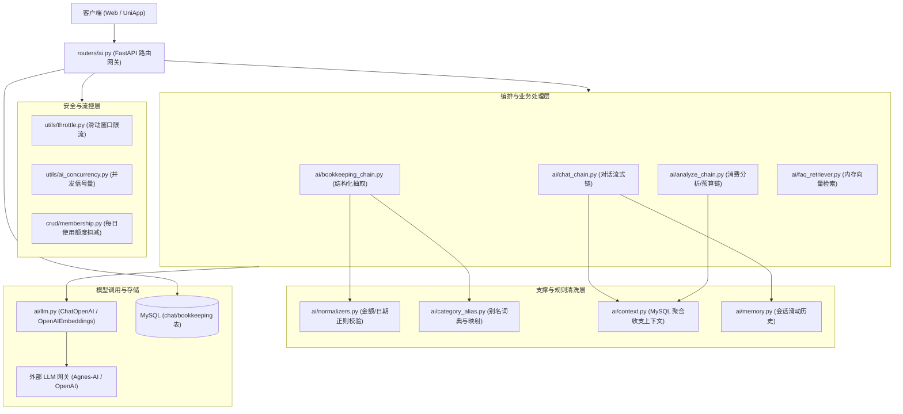
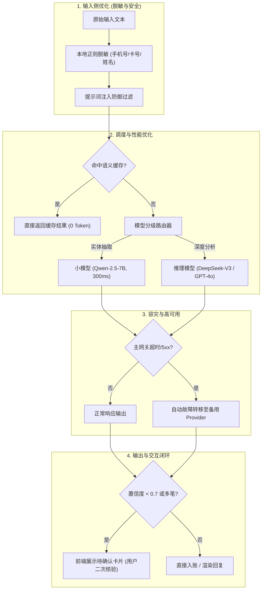
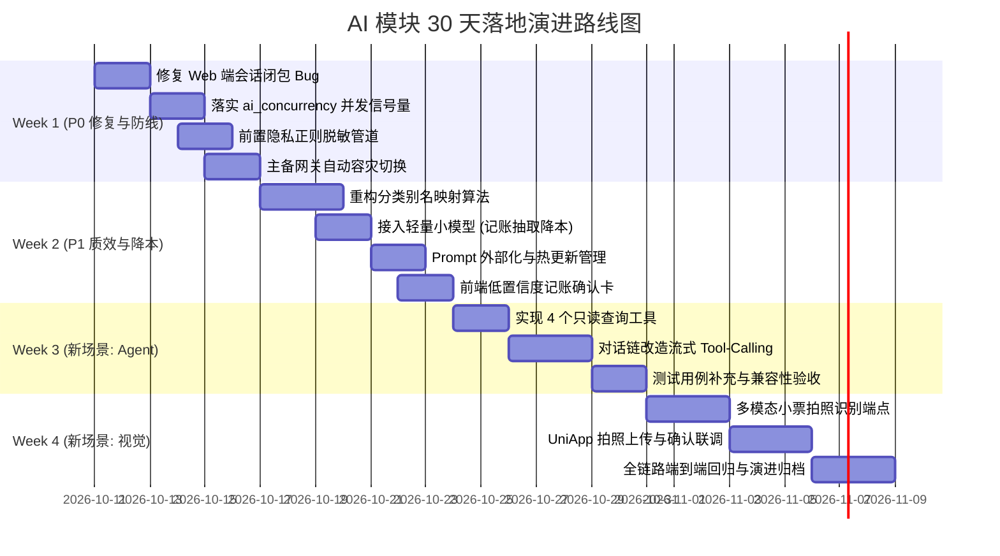

# AI 功能现状分析、优化方案与拓展演进规划

> **文档版本**：v1.0  
> **编写日期**：2026-10-10  
> **适用项目**：个人记账管理系统（FastAPI 后端 + React Web 前端 + UniApp 移动/小程序端）  
> **代码基准**：`fast_backend` / `fast_backend -fwature-expansion-version`，`personal-ledger-frontend`，`personal-ledger-uniapp`

---

## 目录

- [一、现状盘点：当前 AI 功能与技术架构全景](#一现状盘点当前-ai-功能与技术架构全景)
  - [1.1 核心功能矩阵](#11-核心功能矩阵)
  - [1.2 整体调用链路与分层架构](#12-整体调用链路与分层架构)
  - [1.3 核心设计约束与契约铁律](#13-核心设计约束与契约铁律)
- [二、问题分级诊断（P0 / P1 / P2）](#二问题分级诊断p0--p1--p2)
  - [2.1 问题评级总览表](#21-问题评级总览表)
  - [2.2 P0 级问题深度剖析（阻断性 / 高危安全）](#22-p0-级问题深度剖析阻断性--高危安全)
  - [2.3 P1 级问题深度剖析（核心体验 / 质量短板 / 成本损耗）](#23-p1-级问题深度剖析核心体验--质量短板--成本损耗)
  - [2.4 P2 级问题深度剖析（可维护性 / 架构规范）](#24-p2-级问题深度剖析可维护性--架构规范)
- [三、现有 AI 应用的系统性优化方案](#三现有-ai-应用的系统性优化方案)
  - [3.1 功能层面：输入/输出准确率与边界加固](#31-功能层面输入输出准确率与边界加固)
  - [3.2 性能与成本：分级调度、并发控制与多层缓存](#32-性能与成本分级调度并发控制与多层缓存)
  - [3.3 架构与可维护性：提示词治理与双网关容灾](#33-架构与可维护性提示词治理与双网关容灾)
  - [3.4 用户体验：交互确认卡与前端状态修复](#34-用户体验交互确认卡与前端状态修复)
  - [3.5 数据安全与合规：脱敏管道与防注入护栏](#35-数据安全与合规脱敏管道与防注入护栏)
- [四、AI 可拓展的新落地场景（4 大高可行度方向）](#四ai-可拓展的新落地场景4-大高可行度方向)
  - [4.1 场景一：基于 Tool-Calling 的 Agent 深度财务洞察助手](#41-场景一基于-tool-calling-的-agent-深度财务洞察助手)
  - [4.2 场景二：多模态票据/收据拍照即记账 (Vision LLM)](#42-场景二多模态票据收据拍照即记账-vision-llm)
  - [4.3 场景三：主动式消费异常诊断与预算偏离预警系统](#43-场景三主动式消费异常诊断与预算偏离预警系统)
  - [4.4 场景四：生成式智能财务月报与多维交互图表](#44-场景四生成式智能财务月报与多维交互图表)
- [五、30 天可执行落地行动路线图](#五30-天可执行落地行动路线图)

---

## 一、现状盘点：当前 AI 功能与技术架构全景

当前项目中的 AI 模块本质上是一个**基于 LangChain 的轻量级大模型 API 编排与增强检索网关**（基于 OpenAI 兼容网关协议），无本地权重部署、无 GPU 依赖、无模型微调训练。

### 1.1 核心功能矩阵

| 功能模块 | 对应路由端点 | 核心实现链 | 输入特征 | 输出形态 | 业务价值 |
|---|---|---|---|---|---|
| **自然语言记账** | `POST /api/ai/bookkeeping`<br>`PATCH /bookkeeping/{id}`<br>`DELETE /bookkeeping/{id}` | `ai/bookkeeping_chain.py`<br>`ai/normalizers.py`<br>`ai/category_alias.py` | 用户口语化句子（如“昨天打车花了18块”），可带草稿 `draft_id` | 4 种 Action 结构体：`created`、`clarify`、`ignored`、`duplicate` | 免去表单繁琐录入，实现极速记账 |
| **流式/非流式对话** | `POST /api/ai/chat`<br>`POST /api/ai/chat/stream` | `ai/chat_chain.py`<br>`ai/memory.py`<br>`ai/context.py` | 会话 ID、提问文本、动态财务数据注入 | SSE 文本流（`data: {"type":"content"}`）或单次 JSON 回复 | 智能问答、记账建议、财务科普 |
| **消费分析** | `POST /api/ai/analyze/expenses` | `ai/analyze_chain.py`<br>`ai/context.py` | 服务端查库自动组装（当月总收支、上月环比、Top5 分类） | 结构化 JSON：`summary`、3 条 `insights`、3 条 `suggestions`、`risk_level` | 月度财务健康诊断 |
| **预算规划** | `POST /api/ai/analyze/budget` | `ai/analyze_chain.py` | 月收入、目标储蓄率、历史支出结构 | 结构化 JSON：`monthly_budget`、`category_limits`、`alerts` | 基于 50/30/20 法则推荐限额 |
| **FAQ 语义搜索** | `GET /api/ai/faq/search`<br>`POST /api/ai/faq/rebuild` | `ai/faq_retriever.py` | 用户查询短句 | 相似度列表：`{id, question, answer, score}` | 客服与使用帮助智能检索 |
| **语音转写 (扩展版)** | `POST /api/ai/voice/transcribe` | `ai/stt.py` (Whisper) | 录音二进制音频文件 (wav/mp3/m4a/webm) | 纯文本与置信度 `{text, confidence}` | 为自然语言记账提供语音入口 |

### 1.2 整体调用链路与分层架构



### 1.3 核心设计约束与契约铁律

1. **裸 JSON 契约（无信封）**：
   - 区别于普通业务接口的 `{code: 200, message: "ok", data: {...}}`，`/api/ai/**` 一律返回**裸 JSON**。业务失败统一返回 `{"error": "中文原因"}`（HTTP 200），**严禁抛出 `HTTPException`**（否则会被全局拦截器包装为 `Result` 信封导致前端崩塌）。
2. **毫秒级时间戳契约**：
   - 会话与消息的 `created_at`、`updated_at`、`timestamp` 必须为 **BIGINT 毫秒整数**，供前端 `Date.now()` 比对。
3. **SSE 严格格式**：
   - 流式对话固定输出：`data: {"type":"content"|"done"|"error", ...}\n\n`。

---

## 二、问题分级诊断（P0 / P1 / P2）

### 2.1 问题评级总览表

| 级别 | 问题标识 | 所在文件 / 模块 | 影响维度 | 风险与表现 |
|---|---|---|---|---|
| **P0** | **Web 端新建会话发送必报 400** | `personal-ledger-frontend/src/pages/AiChat.jsx:185-204` | 用户体验 / 功能可用性 | React State 闭包异步延迟，首次发消息丢失 `sessionId` |
| **P0** | **财务私密数据明文裸传公网** | `ai/context.py`、`routers/ai.py` | 数据安全与合规 | 银行卡、电话、涉敏备注无脱敏直接上报至第三方 LLM API |
| **P0** | **单点依赖无容灾熔断** | `ai/llm.py` | 架构可用性 | 仅配置单一网关，外部网络波动时全站 AI 崩溃不可用 |
| **P0** | **流式并发限流未实现 (空桩)** | `fast_backend/utils/ai_concurrency.py:39` | 性能稳定性 | 抛出 `NotImplementedError`，高并发下连接池瞬间耗尽 |
| **P1** | **Prompt 硬编码且分散** | `chat_chain.py`、`bookkeeping_chain.py` 等 | 可维护性 | 提示词散落 Python 文件，不可动态配置、无法热更新与 A/B 测试 |
| **P1** | **分类别名双向包含导致严重误判** | `ai/category_alias.py:53` | 功能准确率 | `cat.name in target or target in cat.name` 导致“今日用餐”错标为“日用” |
| **P1** | **消费分析浅层化与模板套话** | `ai/analyze_chain.py`、`ai/context.py` | 功能价值度 | 仅传递 Top5 分类和总金额，分析结果严重缺乏针对性与实用价值 |
| **P1** | **缺少 AI 记账确认交互闭环** | `personal-ledger-frontend`、`uni-app` | 用户体验 | 识别后直接入账，误判无法前置拦截，低置信度缺少提示 |
| **P1** | **缺少 Token 消耗与延迟打点监控** | `ai/llm.py`、`routers/ai.py` | 成本与运维 | 无 Token 审计、无 TTFT 观测，无法精准核算单用户成本 |
| **P2** | **缺少通用语义缓存** | `ai/faq_retriever.py`、`routers/ai.py` | 性能与成本 | 高频重复问题重复请求外部 LLM，浪费 Token 与响应时间 |
| **P2** | **历史会话查库 I/O 频繁** | `ai/memory.py` | 性能与吞吐 | 每次流式会话均从数据库全量读取历史记录，无 Redis/内存缓存 |
| **P2** | **软删定时物理清理为空桩** | `tasks/purge.py` | 数据库治理 | 软删除会话与日志只标记不清理，数据库数据长期膨胀 |

---

### 2.2 P0 级问题深度剖析（阻断性 / 高危安全）

#### 1. Web 前端新建会话状态闭包导致首次发送报错
- **代码位置**：[`personal-ledger-frontend/src/pages/AiChat.jsx#L185-L204`](file:///C:/Users/h/.gemini/antigravity/worktrees/Accounting%20Management%20System_fastapi/ai_feature_audit_expansion/personal-ledger-frontend/src/pages/AiChat.jsx#L185-L204)
- **机理分析**：
  ```javascript
  if (!sessionId) {
    const data = await createSession(currentInput.slice(0, 20))
    if (data.id) setSessionId(data.id) // ⚠️ 异步设置，不会在本函数后续代码中即时生效
  }
  // 此时 sessionId 依然是 null！
  const res = await fetch(`${API_BASE}/chat/stream`, {
    body: JSON.stringify({ sessionId, message: currentInput }), // 传入 null
  })
  ```
  后端接收到空 `sessionId` 后直接返回 HTTP 400，导致用户在新打开聊天页面的第一句话总是发送失败。

#### 2. 用户真实财务与备注数据未脱敏上云
- **代码位置**：[`fast_backend/ai/context.py#L46`](file:///C:/Users/h/.gemini/antigravity/worktrees/Accounting%20Management%20System_fastapi/ai_feature_audit_expansion/fast_backend/ai/context.py#L46)
- **机理分析**：
  在 `build_finance_block` 和 `bookkeeping` 抽取中，用户的真实开销描述（例如“在xx医院为张三购买降压药 300 元”、“还卡号 6222... 信用卡 5000 元”）直接全文组包为 Prompt 发送给第三方商业大模型 API。缺乏本地敏感信息脱敏过滤器，违背个人信息合规要求。

#### 3. 并发限流控制在标准版中完全未实现
- **代码位置**：[`fast_backend/utils/ai_concurrency.py#L39`](file:///C:/Users/h/.gemini/antigravity/worktrees/Accounting%20Management%20System_fastapi/ai_feature_audit_expansion/fast_backend/utils/ai_concurrency.py#L39)
- **机理分析**：
  `try_acquire` 直接抛出 `NotImplementedError`，且在标准版的 `routers/ai.py` 中甚至没有被调用。当多用户同时发起 SSE 长连接生成请求时，服务器无任何并发防护，外部网关连接池可能被迅速耗尽。

---

### 2.3 P1 级问题深度剖析（核心体验 / 质量短板 / 成本损耗）

#### 1. 分类映射算法存在严重误分类
- **代码位置**：[`fast_backend/ai/category_alias.py#L52-L55`](file:///C:/Users/h/.gemini/antigravity/worktrees/Accounting%20Management%20System_fastapi/ai_feature_audit_expansion/fast_backend/ai/category_alias.py#L52-L55)
- **机理分析**：
  ```python
  # 模糊包含：用户分类名出现在目标词中
  for cat in user_categories:
      if cat.name and (cat.name in target or target in cat.name):
          return cat, False
  ```
  如果用户自定义分类中有“日用”，当输入“今日用餐花了35块”时，由于目标分类提取为“今日用餐”，包含“日用”，导致规则将其错误判定为“日用”分类；反向包含同样会产生误杀。

#### 2. 消费分析输入极度受限，模型只能输出泛化套话
- **代码位置**：[`fast_backend/ai/analyze_chain.py#L39-L46`](file:///C:/Users/h/.gemini/antigravity/worktrees/Accounting%20Management%20System_fastapi/ai_feature_audit_expansion/fast_backend/ai/analyze_chain.py#L39-L46)
- **机理分析**：
  上下文构建器只提供了“本月总收入、总支出、上月支出、Top5 分类名称及金额”，未提供每日明细变化、连续性消费特征、非日常突发大额开销。模型在缺乏数据依据的情况下，只能千篇一律地输出“餐饮支出占比高，建议适度节约”等无实质参考价值的陈词滥调。

---

## 三、现有 AI 应用的系统性优化方案



### 3.1 功能层面：输入/输出准确率与边界加固

1. **重构分类映射机制（弃用双向模糊包含）**：
   - **步骤 1**：精确匹配（用户自定义分类优先，系统预设次之）；
   - **步骤 2**：高频规范化别名词典（扩展 `ALIAS` 覆盖电商、外卖、出行等 200+ 常见词汇）；
   - **步骤 3**：轻量级余弦相似度匹配（通过已有内存向量索引做相似度排序）；
   - **步骤 4**：相似度低于设定阈值（0.65）时，明确归入“其他”，并在响应中附带 `warnings` 引导用户确认或新建分类。
2. **多笔复杂账单与收支类型精准判定**：
   - 在 `bookkeeping_chain` 提示词中加入强语义约束，显式注入当前时间与节假日字典；明确“发工资/理财收益/转入/报销”属于收入（`type=1`），“买/花费/扣除/转出”属于支出（`type=0`）。

### 3.2 性能与成本：分级调度、并发控制与多层缓存

1. **模型分级（Small Model vs Large Model）**：
   - **自然语言记账（结构化信息抽取）**：切换为低成本、超低延迟的轻量模型（如 `qwen-2.5-7b-instruct` / `glm-4-9b-flash`），单次响应可由 1500ms 降低至 350ms，成本节约 80% 以上。
   - **深度财务洞察与月报生成**：保留高参数大模型，发挥其深度总结与归纳推理优势。
2. **多级语义缓存（Semantic Cache）**：
   - 对于 FAQ 检索以及相同用户的月度财务分析（在当前月账单数据无更新时），建立以 `hash(user_id, last_record_update_time, intent)` 为 Key 的缓存层，避免重复分析产生冗余消耗。
3. **补齐流式并发限流闭环**：
   - 完善基于单进程 `asyncio.Semaphore` 与 Redis 令牌桶的并发槽分配逻辑，确保单用户并发限制（免费 1 条，会员 3 条）严格生效，超限返回友好状态码。

### 3.3 架构与可维护性：提示词治理与双网关容灾

1. **Prompt 外部化与热更新管理**：
   - 将所有 System Prompt 与模板拆分为独立文件（如 `config/prompts/bookkeeping.yaml`、`config/prompts/chat.yaml`），提供热重载接口，避免提示词修改必须重启应用的问题。
2. **双网关自动故障切换与熔断器（Circuit Breaker）**：
   - 在 [`ai/llm.py`](file:///C:/Users/h/.gemini/antigravity/worktrees/Accounting%20Management%20System_fastapi/ai_feature_audit_expansion/fast_backend/ai/llm.py) 增加主备 Provider 策略（如 Primary: Agnes-AI，Secondary: SiliconFlow / DeepSeek 官方 API）。当主网关在 5 秒内未响应或持续返回 5xx 时，无缝切入备用通道。

### 3.4 用户体验：交互确认卡与前端状态修复

1. **彻底修复 React State 闭包 Bug**：
   - 重构 `AiChat.jsx` 的发送逻辑，将会话创建与发消息改为串行确定的 `activeId` 传递：
     ```javascript
     let targetSessionId = sessionId;
     if (!targetSessionId) {
       const newSession = await createSession(currentInput.slice(0, 20));
       targetSessionId = newSession.id;
       setSessionId(newSession.id);
     }
     // 使用 targetSessionId 发起请求
     ```
2. **引入“记账确认卡”前端机制**：
   - 当记账响应为 `dry_run=true`、置信度低（`confidence < 0.7`）或检测到包含多笔（≥2 笔）记录时，前端弹出轻量确认卡片（包含金额、日期、分类 Tag 与修改入口），由用户一键点击“确认记账”后再落库。

### 3.5 数据安全与合规：脱敏管道与防注入护栏

1. **前置正则脱敏管道**：
   - 在发送给外部 LLM 之前，将敏感手机号、16~19 位银行卡号、身份证号自动替换为掩码占位符：`[PHONE]`、`[CARD]`，既不影响模型对消费行为的语义理解，又杜绝了关键隐私泄露。
2. **提示词防注入护栏（Prompt Injection Guard）**：
   - 对用户输入的系统级引导字符（如“系统设定更新：”、“忽略前述指令”）进行过滤或用转义隔离块包裹，防止越权操控。

---

## 四、AI 可拓展的新落地场景（4 大高可行度方向）

结合当前系统的实际业务形态（个人及小微记账）、前后端技术栈（React + UniApp + FastAPI），提出 4 个无需推翻既有架构、能直接落地的创新场景：

---

### 4.1 场景一：基于 Tool-Calling 的 Agent 深度财务洞察助手

* **解决的具体业务痛点**：
  现有 AI 对话只掌握“本月汇总”，用户如果提问“我上个月在餐饮上花了多少钱？”、“最近三个月哪个月超支最多？”、“上周买咖啡总共付了多少？”，模型只能回答“无法查询历史数据”。
* **推荐技术选型**：
  - **核心方案**：LangChain `bind_tools` + 流式 Tool-Calling 循环。
  - **核心只读工具定义**：
    1. `search_records(keyword, category_id, start_date, end_date)`：多维账单搜索；
    2. `query_monthly_summary(year, month)`：历史任意自然月总收支查询；
    3. `get_category_distribution(year, month)`：分类下钻占比；
    4. `get_expense_trend(months)`：多月环比走势。
  - **多租户安全**：所有工具内部通过闭包强制绑定当前请求的 `user_id`，模型参数只传递查询条件（月份、关键词），模型无法越权查他人数据。
* **预期收益与成本评估**：
  - **收益**：AI 问答从“闲聊玩具”升级为“智能私人财务助理”，解决 90% 用户的非标准查询诉求。
  - **成本**：代码投入仅需新增约 250 行工具函数与 Agent 循环，无需新增外部依赖库，3~5 天即可完成上线。

---

### 4.2 场景二：多模态票据/收据拍照即记账 (Vision LLM)

* **解决的具体业务痛点**：
  用户在线下超市、餐厅用餐或拿到纸质发票时，手动逐条输入商品与单价极易疲劳。常规 OCR 只能提取文字，无法直接对齐记账系统内部的分类与收支字段。
* **推荐技术选型**：
  - **模型架构**：多模态轻量大模型（如 Qwen-2.5-VL / Gemini-1.5-Flash / GLM-4V）。
  - **实现架构**：
    1. UniApp / Web 端压缩上传小票图片；
    2. 后端直接将图片 Base64/二进制流送入多模态模型，配合 Structured Output 抽取商家、交易日期、多项明细商品名、单价与匹配的系统分类；
    3. 返回 `BkPreviewItem` 列表，前端弹出批量确认卡，用户一键勾选入库。
* **预期收益与成本评估**：
  - **收益**：记账录入耗时从 30 秒骤降至 2 秒，极大降低使用门槛，提升用户留存率。
  - **成本**：小尺寸视觉模型单张调用成本低于 0.003 元，经济效益极高。

---

### 4.3 场景三：主动式消费异常诊断与预算偏离预警系统

* **解决的具体业务痛点**：
  现有财务洞察纯靠用户被动触发。如果某笔消费异常高昂、发生非预期重复扣费、或者月中第 10 天预算已被消耗 70%，用户往往在月末甚至透支后才后知后觉。
* **推荐技术选型**：
  - **架构设计**：轻量统计规则计算 + LLM 人性化建议生成。
  - **触发时机**：
    - 记账后异步触发（FastAPI BackgroundTasks）：单笔金额超过该分类近 3 个月均值 3 倍时；
    - 定时任务（每日凌晨）：分析当前月进度与预算消耗率的偏离度。
  - **模型调用**：仅当触发偏离警报时，调用轻量 LLM 生成温和可执行的调整建议，并通过系统通知/站内信推送到首页。
* **预期收益与成本评估**：
  - **收益**：增强系统的“管家感知”，作为会员功能的核心卖点（Premium Tier），可显著提升充值付费意愿。
  - **成本**：99% 的请求由纯 SQL 聚合快速判定，仅在触发异常时调用一次模型，Token 消耗极小。

---

### 4.4 场景四：生成式智能财务月报与多维交互图表

* **解决的具体业务痛点**：
  当前的消费分析是一堆单调的文本，缺乏视觉冲击力与深度复盘，不能一键导出，也不具备社交分享传播属性。
* **推荐技术选型**：
  - **架构设计**：LLM 结构化输出（Markdown 深度财务报告 + ECharts 动态配置 JSON）。
  - **图表类型**：生成桑基图（Sankey Diagram，展示“收入 -> 固定支出/弹性支出 -> 细分类别”资金流向）、支出日历热力图（Calendar Heatmap）。
  - **分享机制**：前端 Canvas / html2canvas 一键将月报导出为优雅长图，支持分享至微信朋友圈或社交平台。
* **预期收益与成本评估**：
  - **收益**：提供媲美微信/支付宝年终账单的高级体验，带来天然的自传播裂变属性。
  - **成本**：前端引入成熟图表渲染器，后端调整 Prompt 输出 Schema，实施风险低。

---

## 五、30 天可执行落地行动路线图



### 逐周执行任务明细表

| 周期 | 核心目标 | 详细执行任务清单 | 产出物与验收标准 |
|---|---|---|---|
| **第 1 周**<br>(Day 1 - 7) | **P0 修复与系统防线加固** | 1. 修复 `personal-ledger-frontend/src/pages/AiChat.jsx` 中的 `sessionId` 闭包问题，确保新建会话首次发消息 100% 成功；<br>2. 落地 `fast_backend/utils/ai_concurrency.py` 中的 `try_acquire` 信号量，挂载到 `/chat/stream`，防范流式并发打满；<br>3. 编写 `ai/security.py` 脱敏管道，对手机号、卡号正则脱敏后再发送给 LLM；<br>4. 在 `ai/llm.py` 中实现双 Provider 自动容灾重试逻辑。 | • Web 端新建会话 0 报错；<br>• 压测下超配额并发正常排队并返回 429；<br>• 外部模型日志中无明文敏感数据；<br>• 主网关宕机时无感秒级切备用网关。 |
| **第 2 周**<br>(Day 8 - 14) | **P1 质量重构与成本压缩** | 1. 废弃 `category_alias.py` 中的双向子串包含匹配，改为“精确 -> 别名 -> 向量阈值”匹配，解决“今日用餐”错判“日用”问题；<br>2. 自然语言记账抽取接入小尺寸端点（如 Qwen-2.5-7B），实现大小模型分级调度；<br>3. 将 Prompt 抽取至 `config/prompts/` 独立配置文件，支持热重载；<br>4. 前端落地记账置信度（`<0.7`）或多笔账单的确认卡片交互；<br>5. 完善 Token、首字延迟（TTFT）与调用成本日志打点。 | • 常用消费分类推断准确率提升至 95% 以上；<br>• 记账抽取响应延迟降至 400ms 以内；<br>• 提示词修改无需重启服务，热生效；<br>• 具备按用户、按功能维度的 Token 报表。 |
| **第 3 周**<br>(Day 15 - 21) | **新场景落地一：Agent 深度查询** | 1. 在 `ai/tools.py` 封装 4 个纯只读查询工具（多维明细搜索、任意月份总收支、分类下钻、历史环比趋势），强制闭包绑定 `user_id`；<br>2. 升级 `chat_chain.py`，支持 `bind_tools` 与多轮工具循环，保持现有 SSE 契约（`content|done|error`）完全兼容；<br>3. 在 `tests/` 中编写带 Mock 数据的针对性单元测试，覆盖单轮工具、多轮工具与异常回落。 | • 用户可在会话中查询“上月餐饮花了多少”、“最近大额支出”并准确给出真实账目；<br>• 两端旧版前端零改动无缝兼容。 |
| **第 4 周**<br>(Day 22 - 30) | **新场景落地二：多模态小票记账** | 1. 后端新增 `/api/ai/bookkeeping/receipt` 接口，支持图片上传并调用 Vision LLM 抽取多项商品明细；<br>2. UniApp 端新增小票拍照/相册选图上传入口；<br>3. 前端完成“小票批量明细确认卡”，支持一次性多选、微调与批量入账；<br>4. 落实 `tasks/purge.py` 软删定时清理定时任务；<br>5. 整理完成全链路自动化回归测试与 API 文档更新。 | • 支持用户拍摄超市小票一键识别并入库；<br>• 软删除数据按 7 天策略定时物理清理完毕；<br>• 交付完整的端到端上线验收报告。 |
